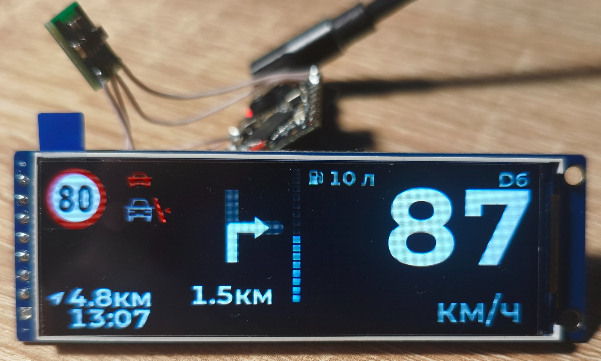
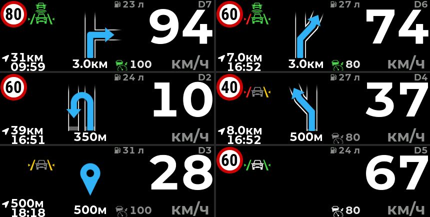
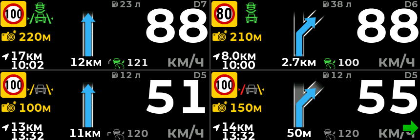
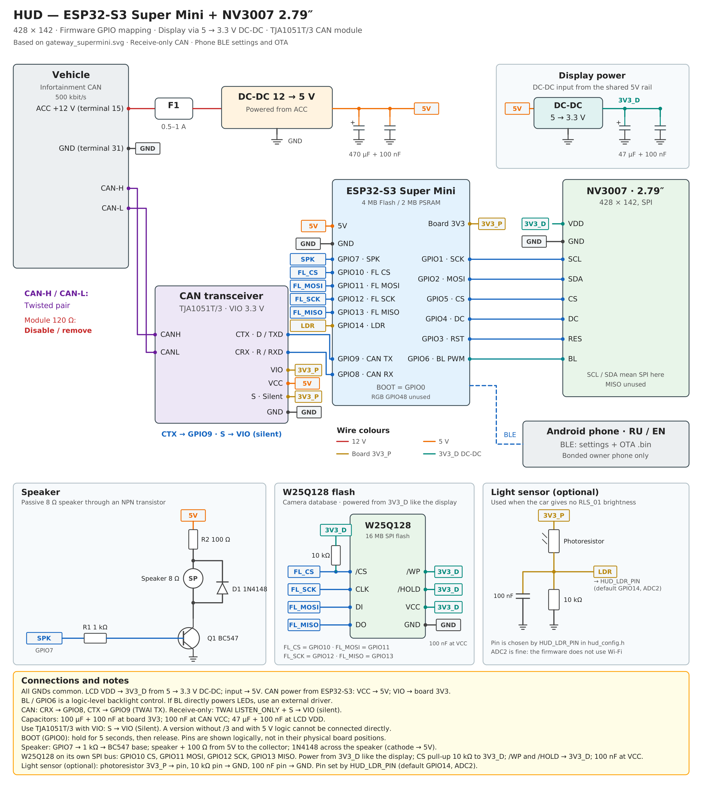
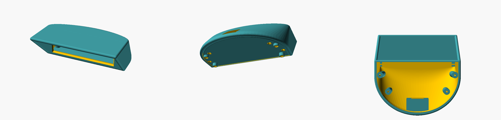
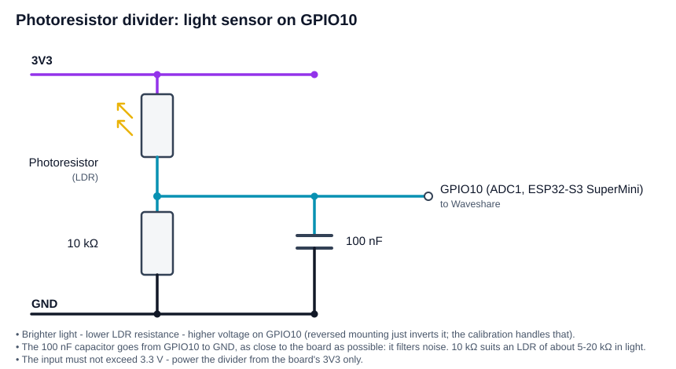
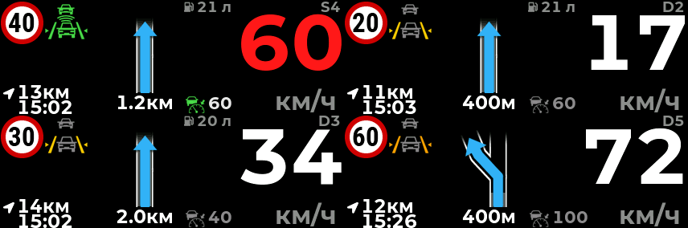
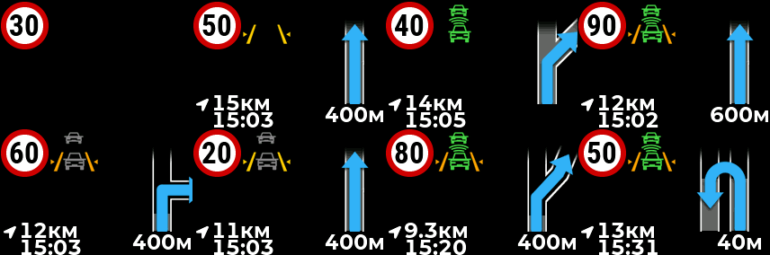

# HUD for Audi A4 B9 (MLB-Evo) — ESP32-S3 Super Mini / NV3007 2.79″ / BLE — v31.0.0

[Русская версия](README_ru.md) · [Android companion app](https://github.com/WARMW00D/HUD-Audi-A4-B9-MLB-Evo-Android-App)

A DIY head-up display showing vehicle data from the Audi Infotainment CAN (MLB-Evo) or the Comfort CAN (MQB): speed, gear, ACC, speed limiter, driver assistance, traffic signs, doors and navigation. This is the compact **428 × 142 NV3007** adaptation of the [Waveshare 3.49″ project](https://github.com/WARMW00D/HUD-Audi-A4-B9-MLB-Evo-Waveshare-ESP32-S3-Touch-LCD-3.49), with Android settings and firmware updates over BLE.

**Verified vehicle configuration:** operation was checked on an **Audi A4 B9 facelift (restyling) with MIB3 High infotainment**.

**Firmware: v31.0.0. Android app: 1.5.0.** This repository contains firmware source and wiring diagrams. Android source lives in its own repository. The prebuilt app firmware in Releases below is v30.0.0 (v30.0.1 changes only the navigation road artwork and the version string); Android 1.5.0 APKs are available there too.

## Tank capacity, acceleration bar and overspeed tolerance

Source versions: **HUD firmware v31.0.0 / Android app 1.5.0 (versionCode 7)**.

- **Tank capacity:** enter a whole number from **1 to 200 litres**; default **54 L**. The capacity is always entered in litres, even with US gallons selected, and updates the HUD fuel-to-add calculation.
- **Acceleration bar:** turn it on or off from the app. When enabled, the existing bar uses valid acceleration/speed data; it remains empty while stationary or without valid data.
- **Overspeed tolerance:** set **0–100 km/h**, default **20 km/h**, always entered in km/h even with mph selected. The speed digits transition smoothly from white to red from 75% of tolerance to 100%; zero makes any positive overspeed fully red.
- All three settings are confirmed by BLE readback and saved in HUD NVS. Existing settings, phone owner and gateway bonds are retained. A BOOT phone-binding reset also retains these settings.

These controls need **app 1.4.1 or newer + firmware v30.0.0**. App 1.4.1 still supports older firmware: missing controls are disabled. Maintainer-supplied APK 1.4.1 and v30.0.0 app-BIN are published in Releases; integrity was verified. If v30.0 and its OTA partition table are already installed, v30.0 uses the same layout; earlier firmware needs the initial USB/partition upgrade described below.

## v31.0.0 changes

- Display: new asynchronous SPI DMA output (`HUD_LCD_ASYNC_DMA`, on by default). Two draw buffers let LVGL render the next strip while the previous one is still being sent. Set it to 0 to return to the old blocking path. `HUD_LCD_DMA_SPI_HZ` sets the clock (default 20 MHz; try 40 MHz only after checking the picture), `HUD_PERF_LOG` prints render/transfer timings to Serial.
- Sound: optional speaker on GPIO7 through a BC547 (`hud_sound`): short beep, double beep, rising chirp and warning pattern. Plays a chirp at start-up (`HUD_SOUND_STARTUP`).
- Pins: GPIO10–13 are reserved for a W25Q128 flash on its own SPI bus (powered from 3V3_D, like the display). The optional light sensor moves to `HUD_LDR_PIN` (default GPIO14, ADC2).
- Wiring diagrams: the `new_pins` drawings (EN/RU) now show the speaker, the W25Q128 and the light sensor.
- Navigation: arrows and roads are taken from the Waveshare project (`tools/gen_nav_images.py`, native 192 × 116 area). The side distance bar is removed and its space is used by the larger arrow area. The distance to the manoeuvre now stands on the level of the ACC speed. The road is empty when the manoeuvre is far and fills with the standard grey from the bottom up as the car approaches (same `bargraph` data the bar used). The camera distance uses the larger route font, written without a space (`330м` / `330m`).
- Speed cameras: GPS position and heading come from the car's CAN (NavPos_01 0x486, NavData_01 0x484). The database `cams.bin` (from `gen_cams.py`) lives in the W25Q128 flash and is loaded into PSRAM at start-up; `cam_alert` finds the nearest camera ahead by binary search, no index file is needed. The sign (yellow square, limit disc, camera icon, distance) and the speed-digit colouring follow the Waveshare design; a warning sound plays when the speed is over the camera limit (`HUD_CAMS`, `HUD_CAM_*` in `hud_config.h`).
- Camera display, camera warning sound and sound volume (0–100 %, 0 = silent) are switchable from the Android app (new BLE settings `…000D`, `…000E`, `…000F`, kept in NVS).
- Camera database upload from the Android app over BLE, streamed with automatic resume and no restart: `docs/CAMS_UPLOAD.md`. Needs app **1.5.0**.
- MQB (early support): new `HUD_PLATFORM` switch in `hud_config.h` (`HUD_PLATFORM_MLB_EVO` by default, or `HUD_PLATFORM_MQB`). On MQB the ACL and decoder take ACC from `0x2A7` / `0x30C` (active state, set speed, vehicle ahead), skip the absent `0x2A9` / `0x64F` and read the brightness regulator from `0x5F0`. Tested only on replayed logs of a Skoda Octavia A7; see "Vehicle platform: MLB-Evo and MQB" below for the signal table and open points.

## v30.0.1 changes

- One version source: the boot banner uses `HUD_FW_VERSION_STRING` from `hud_config.h` (it used to disagree with the README).
- Documentation: OTA guides updated to v30.0 / app 1.4.1; real-device OTA is confirmed (see below).

## v30.0.0 rendering changes

- Native output at **428 × 142**; the previous 518 × 172 intermediate canvas and its scaling pass are removed.
- The speed outline is removed. One speed label changes colour smoothly from white to red as the displayed limit is approached.
- Navigation artwork and road masks are retained from the working 29.1.9 build.

## HUD on hardware



Photo supplied by WARMW00D: speed, gear, speed-limit sign, navigation and fuel information on the NV3007 display.

### Screens from real MLB-Evo logs

Rendered from Audi A4 B9 (MLB-Evo) CAN logs through the real decoder and UI (host render of the 428×142 panel): navigation arrows, speed-limit signs, ACC with the set speed, Lane Assist, destination.



Speed-camera alerts (camera icon, distance and limit) in the same renders:



## Download firmware BIN

[v30.0 release](https://github.com/WARMW00D/HUD-Audi-A4-B9-MLB-Evo-ESP32-S3-SuperMini-LCD-2.79-NV3007-BLE/releases/tag/v30.0.0) · [App-BIN](https://github.com/WARMW00D/HUD-Audi-A4-B9-MLB-Evo-ESP32-S3-SuperMini-LCD-2.79-NV3007-BLE/releases/download/v30.0.0/HUD-SuperMini-v30.0.0-app.bin) · [SHA-256](https://github.com/WARMW00D/HUD-Audi-A4-B9-MLB-Evo-ESP32-S3-SuperMini-LCD-2.79-NV3007-BLE/releases/download/v30.0.0/SHA256SUMS-v30.0.0.txt).

Maintainer-supplied image, **1,149,616 bytes**. ESP32-S3 header, image checksum and SHA-256 were verified. **OTA application only**: no bootloader or partition table. Initial installation requires USB with the project `partitions.csv`; this app-BIN cannot migrate partitions. The v30.0 two-slot OTA layout is compatible. BLE OTA transfer to the HUD has been confirmed on the real device by the maintainer.

## Download Android APK

[Version 1.5.0](https://github.com/WARMW00D/HUD-Audi-A4-B9-MLB-Evo-Android-App/releases/tag/v1.5.0) — real-device OTA has been confirmed by the maintainer.

- [Release APK](https://github.com/WARMW00D/HUD-Audi-A4-B9-MLB-Evo-Android-App/releases/download/v1.5.0/HUD-Control-1.5.0-release.apk) — normal installation.
- [Debug APK](https://github.com/WARMW00D/HUD-Audi-A4-B9-MLB-Evo-Android-App/releases/download/v1.5.0/HUD-Control-1.5.0-debug.apk) — `testOnly=true`: `adb install -r -t HUD-Control-1.5.0-debug.apk`.
- [SHA-256](https://github.com/WARMW00D/HUD-Audi-A4-B9-MLB-Evo-Android-App/releases/download/v1.5.0/SHA256SUMS-1.5.0.txt).

WARMW00D supplied these builds: version 1.5.0 (versionCode 7). APK v2 signatures and content digests were verified. Each flavor retains its previous signing key: release updates release and debug updates debug. Switching flavors requires uninstalling the app and loses its local settings.

## What the HUD shows

| Element | Behaviour |
|---|---|
| Speed and gearbox | Cluster digital speed; P/R/N/D/S/M/E/Offroad and gear number when available |
| ACC and limiter | Set speed, ACC target and traffic jam assist; LIM replaces the ACC set-speed icon |
| Lane / Side Assist | Lane detection, steering and warnings; red lines for blind-spot indications |
| Traffic signs | Main sign: valid VZE → explicit PSD → PSD legal limit; additional signs cycle |
| Overspeed | Speed digits fade smoothly from white to red near the displayed main limit |
| Navigation | Main maneuver, next maneuver, distance, progress as road fill, destination distance and time |
| Doors / pre sense | Open vehicle parts replace navigation; pre sense has higher priority |
| Turn signals | Green arrows; hazard lights use red |
| Fuel | Amount to fill and consumption strip when the required data is available |
| Acceleration | Optional bar, selected by build-time configuration |
| Brightness | Vehicle light sensor × dimmer wheel; night range **2–40**, sunlight **200–255** |
| Settings | PSD, VZE, HUD language, distance/speed units and fuel-volume units; stored in NVS |

Stale fields are hidden. A signal must exist on your car’s bus to be displayed. This board has no Waveshare touch controller, audio codec or SD logging; settings use the phone. The phone app language is independent of the HUD language.

## Architecture

The HUD decodes raw frames locally using `can_decode.c`. Select the source in `supermini_hud/hud_config.h`:

| Mode | Source |
|---|---|
| `HUD_SRC_AUTO` — default | Own CAN while frames arrive; after 1 s of silence, use the BLE gateway |
| `HUD_SRC_TWAI` | Direct CAN through TJA1051T/3, TWAI `LISTEN_ONLY` |
| `HUD_SRC_BLE` | Raw CAN frames from a compatible gateway / sniffer |
| `HUD_SRC_FAKE` | Built-in generator for bench testing |

The [CAN sniffer / BLE gateway](https://github.com/WARMW00D/esp32-CAN-sniffer-logger-screener) uses the ACL protocol (firmware 2.6.0+). The HUD sends its ACL after every gateway connection. Phone settings and OTA are separate GATT services; NimBLE acts as both gateway client and phone server. First-time gateway pairing waits if the phone is connected.

LVGL renders directly at the physical 428 × 142 resolution and sends only changed strips over SPI. The native test build removes the 518 × 172 → 428 × 142 scaling step; the partial buffer fits in internal RAM. No LVGL calls should be added from BLE callbacks.

[CAN signals and gateway protocol](docs/CAN.md) · [BLE settings, Russian](supermini_hud/BLE_SETTINGS_ru.md)

## Hardware and wiring

- **ESP32-S3 Super Mini:** the project targets the supplied 4 MB Flash / 2 MB QSPI PSRAM board. Check your board variant.
- **NV3007 2.79″:** 428 × 142, SPI, with a logic backlight-control input.
- **TJA1051T/3:** VIO-equipped CAN module with a 3.3 V logic interface.
- ACC 12 V → external DC-DC 12→5 V. The 5 V rail supplies the ESP32 board and the **input** of a separate DC-DC 5→3.3 V for the display.

**Display VDD comes from the separate converter’s 3.3 V output (`3V3_D`). Do not connect that output to the board’s 3V3 pin (`3V3_P`).** All grounds are common. CAN-module VCC comes from the board’s 5V pin; VIO and S come from the board’s 3V3 pin. SN65HVD230 is not used.



[Editable SVG](schematics/HUD_supermini_NV3007_rev3_en_new_pins.svg) · [PDF](schematics/HUD_supermini_NV3007_rev3_en_new_pins.pdf)

| ESP32-S3 | Connection |
|---|---|
| GPIO1 | LCD SCL / SPI SCK |
| GPIO2 | LCD SDA / SPI MOSI |
| GPIO5 | LCD CS |
| GPIO4 | LCD DC |
| GPIO3 | LCD RES |
| GPIO6 | LCD BL / PWM |
| GPIO8 | CAN CRX / RXD |
| GPIO9 | TWAI TX → CAN CTX / TXD (wire it; in `LISTEN_ONLY` the controller keeps it recessive) |
| GPIO0 | On-board BOOT button |

CAN CTX/TXD → GPIO9; S → VIO for silent mode. Do not leave CTX/TXD floating: a floating TXD is not guaranteed to stay recessive on every module. CAN-H / CAN-L are a twisted pair. Disable the module’s 120 Ω termination when connecting to an already terminated vehicle bus. Receive-only protection combines TWAI `LISTEN_ONLY` and hardware silent mode (S → VIO); silent mode keeps the transmitter off even while the ESP32 boots or resets. SCL/SDA labels on this display refer to SPI, not I²C; MISO is unused. If BL directly powers LEDs instead of being a logic input, use a suitable external driver.

The drawing is a wiring diagram, not a PCB layout or a complete automotive power-protection design. USB power isolation is not drawn; account for it when flashing while external 5 V is connected.

## 3D-printed enclosure

The [`case/`](case/) folder contains an ASA enclosure for the NV3007 2.79″ display: a top shell with a visor and a bottom plate secured with screws from below.



| Part | STL for printing | STEP for CAD |
|---|---|---|
| Top shell with visor | [STL](case/supermini_hud_shell.stl) | [STEP](case/supermini_hud_shell.step) |
| Top shell with long visor, variant 2 | [STL](case/supermini_hud_shell_var2.stl) | [STEP](case/supermini_hud_shell_var2.step) |
| Bottom plate with feet | [STL](case/supermini_hud_plate.stl) | [STEP](case/supermini_hud_plate.step) |
| Bottom plate without feet | [STL](case/supermini_hud_plate_nofeet.stl) | [STEP](case/supermini_hud_plate_nofeet.step) |
| Separate feet | [STL](case/supermini_hud_feet.stl) | [STEP](case/supermini_hud_feet.step) |

[Parametric OpenSCAD source](case/supermini_hud.scad). Dimensions are in millimetres. Use `PART` to select `assembly`, `shell`, `plate`, `plate_nofeet` or `feet`. The model is designed for **ASA**.

## Build and first USB installation

Open `supermini_hud/supermini_hud.ino` in Arduino IDE. Keep the sketch-folder name `supermini_hud`.

| Item | Project configuration |
|---|---|
| Board | ESP32S3 Dev Module |
| Arduino ESP32 core | 3.3.10, as in the supplied working board configuration |
| CPU | 240 MHz |
| Flash | 4 MB, QIO / 80 MHz, matching your working board |
| PSRAM | QSPI, 2 MB; not OPI |
| USB CDC On Boot | Enabled |
| Partition table | Custom `supermini_hud/partitions.csv` |
| Serial | 115200 |
| Libraries | LVGL 8.4.0; NimBLE-Arduino 2.x / API 2.5.1; Arduino_GFX with `Arduino_NV3007` support |

Put `supermini_hud/config/lv_conf.h` next to the installed `lvgl/` directory. Required: `LV_COLOR_DEPTH 16`, `LV_USE_FONT_COMPRESSED 1`. LVGL 9 is not supported. Both `LV_COLOR_16_SWAP` settings are handled by the display port.

**Upgrading v28.x → v30.0 requires USB flashing of the new partition table. Set Erase All Flash to Disabled.** Confirm the build uses the supplied CSV and writes the table at 0x8000; flashing only the application does not migrate partitions. NVS remains at 0x9000 with size 0x5000, so settings and bonds are intended to survive, subject to device verification.

Two OTA slots are **0x1F0000 / 2,031,616 bytes** each. Check the compiled application size. The first boot should report `[fw] HUD Super Mini v31.0.0 / BLE OTA` and a next-slot capacity of 2031616.

For gateway authentication, copy `secrets.example.h` to `secrets.h` and set its `BLE_PASSKEY` to match the gateway. `secrets.h` is ignored by Git. This is separate from the phone PIN, `HUD_SETTINGS_PIN` in `user_config.h`.


### Optional photoresistor light sensor

The SuperMini can use an optional photoresistor divider on **`HUD_LDR_PIN`** (default GPIO14, ADC2; GPIO10–13 are reserved for the W25Q128, GPIO7 for the speaker) when RLS_01 light data is unavailable. Connect the LDR from 3V3 to that pin, a 10 kΩ resistor from it to GND, and optionally 100 nF from it to GND. Calibration is available in the Android app: close the sensor and save the dark point once, then illuminate it with a bright flashlight and save the bright point once.



## Android settings and BLE OTA

1. Download the APK above or build and install the [Android app](https://github.com/WARMW00D/HUD-Audi-A4-B9-MLB-Evo-Android-App).
2. Find `HUD-SuperMini`, connect and complete Android bonding. Phone pairing PIN: see `HUD_SETTINGS_PIN` in [`user_config.h`](supermini_hud/user_config.h).
3. The first authenticated phone becomes the owner. Settings changes are read back and stored in NVS.
4. For OTA, export **`supermini_hud.ino.bin`** from Arduino IDE. Select that application image in the app, then confirm the update.
5. Keep power stable and the phone app open. After verification and boot-slot selection, the HUD reboots; reconnect and check operation.

Do not use bootloader, partition, merged images or flash dumps for OTA. The transfer validates offsets, SHA-256, the ESP32-S3 application header and the ESP-IDF image before selecting the new slot. Only the bonded, authenticated owner may update. A lost final acknowledgment can mean the update has already committed; follow the app’s restart/check message before retrying. Functional rollback of a faulty new program is not guaranteed; USB is the recovery method.

To replace the phone: while the HUD is running, hold **BOOT for 5 s and release**. Only the phone ownership/bonds are reset; HUD settings and gateway keys remain. Remove the old HUD bond on the phone before pairing again. Do not hold BOOT during power-on/reset.

[Full OTA guide](docs/OTA.md) · [Полная инструкция OTA](docs/OTA_ru.md)

## Configuration and diagnostics

`user_config.h` defines LCD GPIO, orientation, column offsets, SPI clock, phone name/PIN and BOOT. `hud_config.h` defines data source, sign selection defaults, units, tank size, brightness and Serial logging. Stored phone settings override initial defaults.

| Setting | Default |
|---|---|
| `HUD_CAN_RX_PIN` / `HUD_CAN_TX_PIN` | 8 / 9, TX wired to CTX/TXD |
| `HUD_CAN_BITRATE_K` | 500 |
| `HUD_LCD_SPI_HZ` / `HUD_LCD_ROTATION` | 20 MHz / 1 |
| `HUD_BR_DARK_WHEEL_MIN` / `_MAX` | 2 / 40 |
| `HUD_BR_BRIGHT_WHEEL_MIN` / `_MAX` | 200 / 255 |
| `HUD_LANG` / `HUD_UNITS` | RU / km |
| `HUD_TANK_L` | 54 L |

For bench testing, use `HUD_SRC_FAKE` or a compatible BLE log player. Enable `HUD_LOG_CAN` / `HUD_LOG_STAT` to diagnose missing frames; a field disappearing on timeout does not necessarily indicate a rendering problem. Use `tools/can_bitdiff.py` to inspect changing CAN bits.

| Symptom | Check |
|---|---|
| Custom text missing | `LV_USE_FONT_COMPRESSED 1` and LVGL 8 |
| Black screen / allocation error | QSPI PSRAM enabled, GPIO, power, LCD rotation and column offsets |
| No gateway data | Gateway ACL protocol, name, bonding/passkey and source mode |
| OTA service absent | Install v30.0 over USB; reconnect after Service Changed; check slot capacity |
| App reconnect fails after removing Android bond | Reset phone ownership with BOOT, then pair again |

## Vehicle platform: MLB-Evo and MQB

`HUD_PLATFORM` in `hud_config.h` (or `-DHUD_PLATFORM=HUD_PLATFORM_MQB`) selects the signal map: `HUD_PLATFORM_MLB_EVO` (default, Audi A4 B9 and other MLB-Evo, tested) or `HUD_PLATFORM_MQB` (VAG MQB, early community support). Everything not tied to the bus (UI, cameras, menu, OTA) is shared. The ACL list for the sniffer/gateway and the decoder follow the selected platform.

**Bus:** on MLB-Evo the HUD connects to the Infotainment CAN, on MQB to the Comfort CAN (500 kbit/s on both); the schematics carry both labels.

Wire colors at the vehicle connector:

| Line | MLB-Evo | MQB |
|---|---|---|
| CAN-H | violet | orange-green |
| CAN-L | orange-brown | orange-brown |

Use a twisted pair to the CAN module. Verify the colors on your car before connecting.

MQB was checked only with logs from one Skoda Octavia A7 (pre-facelift, retrofitted Virtual Cockpit), replayed through the BLE player; the cluster itself was not recorded, so ⚠️ means a hypothesis from the log.

| Signal | MLB-Evo | MQB | MQB status |
|---|---|---|---|
| Speed, gear, turn signals, doors, speed-limit signs (VZE), Side Assist | same frames | same frames | works on replay |
| ACC active | `0x2A8` 16\|3 | `0x2A7` bit 58 | ⚠️ matches `0x30C` bit 61 in time |
| ACC set speed | `0x2A6` 12\|10, ×0.32 km/h | `0x30C` 16\|6: 5·v+5 km/h, 63 = not set | ⚠️ values 5/7/9/11/19 give 30/40/50/60/100 |
| Vehicle ahead, time gap | `0x2A6` 45\|2 / 37\|3 | `0x30C` 45\|2 / 37\|3 | ⚠️ same layout assumed |
| ACC lane guidance, traffic-jam mode | `0x2A6` 7\|2 / 62\|2 | not decoded | missing |
| Pre sense | `0x2A9` | frame absent | disabled |
| Lane Assist | `0x397` | `0x397`, same decoder; ACL without rate limit (green lasts 0.1–1 s) | works; warning flags not seen in the log |
| Brightness | `0x5F0` + light sensor `0x5A0` + wheel `0x64F` | `0x5F0` byte 0; wheel from `0x5F0` byte 2 (16\|8); `0x5A0` and `0x64F` absent | ⚠️ wheel byte seen only at 100 (lights off) |

Rendered from the Octavia A7 logs through the real decoder and UI (host render of the 428×142 panel; speed-limit signs, ACC with a vehicle ahead, Lane Assist lines):





Open for MQB contributors: confirm ACC bits against the cluster, find ACC lane guidance and traffic-jam mode, light sensor and wheel behaviour with the lights on, navigation arrows (BAP differs from MLB-Evo), and a two-bus (Powertrain/Comfort) data path.

## Validation status

WARMW00D supplied the v30.0.0 ESP32-S3 application BIN and Android v1.4.1 APKs. Firmware image checksum/SHA-256 and APK signatures/content digests were verified. Host tests pass. Builds were not run here; Android lint has not been run. The maintainer confirmed BLE OTA on the real device.

Host tests cover real SHA-256 through OpenSSL with mocked NimBLE/ESP-IDF: full transfer, commit only after verification, invalid size/header/chip/hash, flash failures, offsets, cancel/disconnect/timeout, owner authorization, duplicate commit and lost final ACK. Display scaling, dirty strips, decoder and settings/NVS also have host tests. Mocks do not establish real BLE interoperability or flash reliability.

Example from `supermini_hud/` (g++ and OpenSSL development headers required):

```sh
g++ -std=c++17 -Wno-deprecated-declarations -Itests/settings_stubs tests/test_ble_ota.cpp -lcrypto -o /tmp/hud_test_ota
/tmp/hud_test_ota
g++ -std=c++17 -Wno-deprecated-declarations -Itests/settings_stubs tests/test_ble_settings.cpp -lcrypto -o /tmp/hud_test_settings
/tmp/hud_test_settings
```

CAN signal verification depends on the vehicle and equipment. The inherited observations and remaining uncertainties are in [CAN reference](docs/CAN.md). Firmware integrity checks are not a digital signature or proof that a third-party ESP32-S3 image is compatible.

## Files

- `case/` — enclosure models (STL/STEP), parametric OpenSCAD source and preview.
- `supermini_hud/` — Arduino sketch, decoder, LVGL interface, SPI port, BLE gateway client, phone settings and OTA server.
- `supermini_hud/config/` — LVGL configuration example.
- `supermini_hud/tests/` — host tests and stubs.
- `supermini_hud/tools/` — image/font generators, previews and CAN utilities.
- `docs/` — OTA and CAN/gateway guides in English and Russian.
- `schematics/` — Russian and English revision 3 SVG, PNG and PDF with the Infotainment CAN (MLB-Evo) / Comfort CAN (MQB) label; display DC-DC input is 5 V. Revision 2 remains available.

## Safety and legal notes

### Disclaimer and responsibility

This section supplements the MIT licence in [LICENSE](LICENSE) and does not replace it. It is not legal advice.

1. **"As is", no warranty.** The hardware designs, firmware, tools, documentation and other materials in this repository (the "Project") are provided "as is" and "as available", without warranties of any kind, express or implied, including merchantability, fitness for a particular purpose, accuracy, completeness, non-infringement and uninterrupted or error-free operation.
2. **Limitation of liability.** To the maximum extent permitted by applicable law, the authors and contributors are not liable for any direct, indirect, incidental, special, consequential or other damages or losses arising from the Project or its use, including but not limited to: damage to or failure of a vehicle, its electrical system, control units, bus or other equipment; loss of the manufacturer's or seller's warranty or of type approval / roadworthiness; fire, personal injury or death; traffic accidents; fines, penalties, confiscation of equipment or other legal consequences; loss of data. Nothing in this notice excludes or limits liability that cannot be excluded or limited under applicable law.
3. **Responsibility of the user.** Everyone who builds, installs, modifies, connects to a vehicle or uses the Project or any part of it does so **solely at their own risk and bears all responsibility** for the result, including correct wiring and power supply, safe installation and compliance with the law. The authors have not verified the Project on every vehicle, model year, equipment variant or software version, and the descriptions of signals and wiring may be incomplete or wrong. If you are not sure what you are doing, do not connect anything to the vehicle.
4. **Not a safety system.** The HUD is an auxiliary display. Displayed values (speed, speed limits and signs, camera warnings, ACC / Lane Assist / Pre Sense states, navigation, fuel and others) may be wrong, delayed, missing or misleading. The driver remains fully responsible for driving, for observing traffic signs and rules, and must rely on the vehicle's own instruments and on the road situation, not on this device. Install and set it up so that it does not distract and does not obstruct the view or airbag zones.
5. **Speed-camera warnings and local law.** In some countries and regions the use, possession or installation of devices, software or data that warn about speed cameras or police checkpoints (or that show their positions) is restricted or prohibited. The camera feature (`HUD_CAMS`) is optional and can be disabled at compile time and in the menu. **You alone are responsible for checking and complying with the laws of every country you drive in.** The camera database is **not** part of this repository: the files you load come from third parties, their terms of use apply, and the data may be incomplete, outdated or wrong. The same applies to other regulations (vehicle modification and approval rules, rules on devices in the driver's field of view, privacy, radio / electronic equipment rules).
6. **Vehicle data and third parties.** The Project only listens to the vehicle bus; the signal descriptions come from public sources and from the author's own observations for interoperability and personal use. Check that you are entitled to access and modify your vehicle and that doing so does not breach your agreements (warranty, leasing, insurance) or the law. Do not use the Project on vehicles you do not own or have no permission to modify.
7. **Trademarks.** Audi, Volkswagen, VAG, MIB, MLB and other names and marks belong to their owners and are used only to describe compatibility. The Project is independent and is not affiliated with, endorsed or approved by them.
8. **Compensation.** To the extent permitted by applicable law, a person who builds or uses the Project and passes it on to others is responsible for it towards those others, and agrees not to make claims against the authors and contributors for damage arising from the Project and, if such claims are made by third parties because of that person's use, to compensate the authors and contributors for the resulting losses.
9. **Third-party materials** (fonts, icons, libraries, data) are covered by their own licences and terms, see below.

If you do not agree with these terms, do not build or use the Project.

## Credits and license

- **WARMW00D (Warmwood):** project owner, hardware integration, vehicle logs and testing.
- **Claude (Anthropic):** development assistance acknowledged by the original Waveshare project.
- **OpenAI Codex / ChatGPT:** assistance with the SuperMini/NV3007 adaptation, BLE settings, Android RU/EN app, BLE OTA, host tests, wiring diagrams and documentation. Generated changes still require maintainer review and hardware validation.
- [CAN sniffer/gateway](https://github.com/WARMW00D/esp32-CAN-sniffer-logger-screener), opendbc/openpilot and revag-bap — data transport and signal/protocol references.
- Waveshare — original project context; Arduino_GFX, LVGL and NimBLE-Arduino — display and BLE libraries.
- Montserrat and Roboto Condensed — fonts under SIL OFL 1.1, licenses in `supermini_hud/tools/fonts/`.

Project code and documentation: [MIT](LICENSE), retaining the original Warmwood copyright. Third-party assets retain their own licenses; the original README notes that `tools/icons/acc_set.png` came from an external source. This hobby project is not affiliated with AUDI AG or Volkswagen AG.
